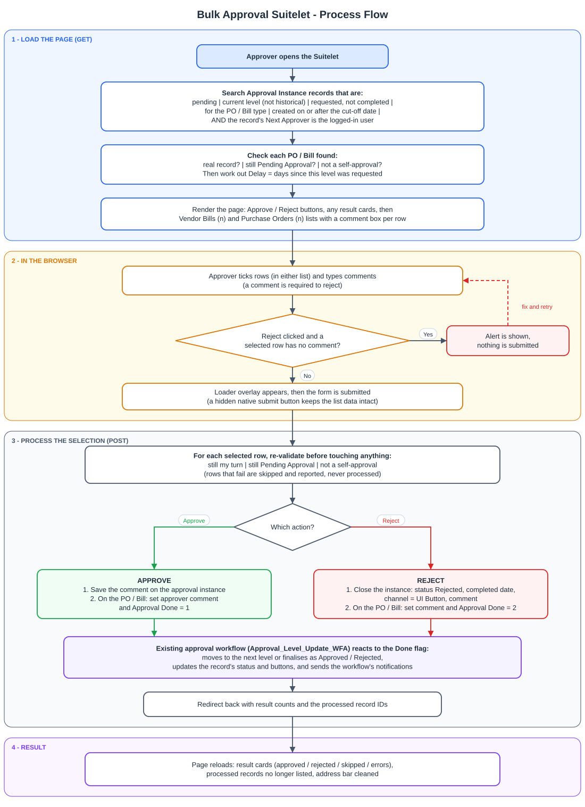
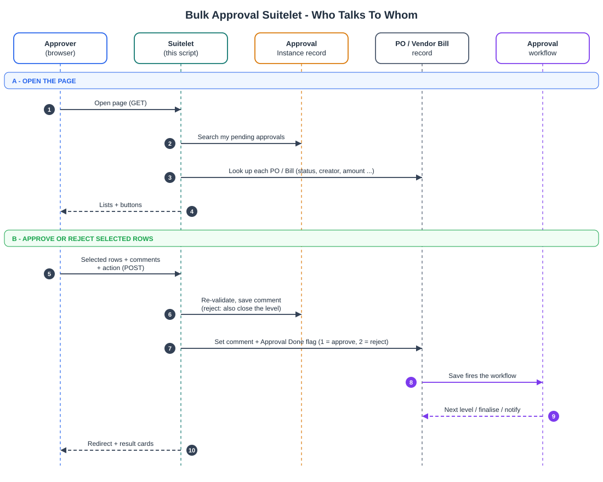

# Bulk Approval Suitelet - Vendor Bills & Purchase Orders

**Author:** Daksh Chauhan

> Reference implementation for portfolio/interview walkthrough. Company-specific
> names and record IDs are genericized (`demo`/`DEMO` prefixes). Scripts are shared
> as code samples, not a drop-in deployable package. Runtime behavior has not been
> re-tested outside the original environment: the safeguards described are the
> intended behavior as written in the code.

One page where an approver sees every **Vendor Bill** and **Purchase Order** waiting on them,
and can **approve or reject many at once** - using the same rules and the same approval
workflow as approving from the record itself.

| | |
|---|---|
| Script type | Suitelet (SuiteScript 2.1) |
| Page title | *Transactions Pending My Approval* |
| Records covered | Vendor Bill, Purchase Order |
| Source | [`src/DEMO_Bulk_Approval_Suitelet.js`](src/DEMO_Bulk_Approval_Suitelet.js) |
| Diagrams | [`docs/process-flow.svg`](docs/process-flow.svg), [`docs/sequence.svg`](docs/sequence.svg) (rendered below) |

---

## Contents

1. [What it does](#1-what-it-does)
2. [Benefits](#2-benefits)
3. [What the page looks like](#3-what-the-page-looks-like)
4. [Process flow](#4-process-flow)
5. [How the pieces talk to each other](#5-how-the-pieces-talk-to-each-other)
6. [What appears in the lists](#6-what-appears-in-the-lists)
7. [Approve vs Reject - what gets written](#7-approve-vs-reject---what-gets-written)
8. [Columns](#8-columns)
9. [Built-in safeguards](#9-built-in-safeguards)
10. [Configuration & field reference](#10-configuration--field-reference)
11. [Deployment](#11-deployment)
12. [Known limitations & pre-go-live checks](#12-known-limitations--pre-go-live-checks)
13. [Code map](#13-code-map)

---

## 1. What it does

- Shows **two lists** (rendered as tabs) - **Vendor Bills (n)** and **Purchase Orders (n)** -
  containing only the items that are waiting on the logged-in user.
- Has **one shared pair of buttons**, *Approve Selected* and *Reject Selected*. Ticking rows in
  either list and clicking once processes them all.
- Gives every row an **Approver Comment** box. The comment is **mandatory when rejecting**.
- Does **not** re-implement approval-level logic. It records the decision and sets the same
  "Approval Done" flag the existing approval workflow already listens to, then lets that workflow
  do the rest (next level, final approval/rejection, status, notifications).
- Shows a **loader** while processing, then **result cards** (approved / rejected / skipped /
  errors) when the page reloads.

---

## 2. Benefits

| Benefit | How it is achieved |
|---|---|
| **Far fewer clicks** | Approvers work from one screen with multi-select instead of opening each record. Both record types live on the same page. |
| **Same process as everywhere else** | The decision is handed to the existing approval workflow through the same "Approval Done" flag (1 = approve, 2 = reject) used by the email-reply approval path. Multi-level routing, status changes and notifications stay in one place instead of being duplicated here. |
| **Rejection always has a reason** | Checked in the browser (alert, nothing is sent) *and* again on the server (row skipped and reported). |
| **No self-approval** | If the creator of a PO/Bill is also its next approver and is the one logged in, it is hidden from the list - and blocked again at submit time. |
| **Fewer stale or wrong actions** | Every row is re-validated at submit time; just-processed records are removed from the next page load immediately; records that do not resolve to a real PO/Bill are skipped instead of showing a dead link. |
| **Audit trail** | The comment is stored on the approval instance and on the record. A rejection also closes the instance with status *Rejected*, a completed date, and channel *UI Button*. |
| **Easier prioritising** | *Delay (Days)*, *Requestor*, *Transaction Amount* and *Currency* are visible at a glance in the list. |
| **Focus on current work** | A cut-off date keeps legacy items out of the queue. |
| **Clear feedback** | Loader overlay, colour-coded result cards, and a named reason for every skipped or failed record. |
| **One failure does not block the rest** | Each record is processed in its own try/catch; the others still go through. |
| **Low maintenance** | No hard-coded script or deployment IDs (the redirect uses the running script). The two record types are described by one small config function. |

---

## 3. What the page looks like

```
Transactions Pending My Approval
[ Approve Selected ] [ Reject Selected ]            <- always directly under the title

+-------------------------------------------------------------------------------+
| (v) 2 record(s) submitted for approval.                  <- result cards       |
| (x) 1 record(s) rejected.                                   (only after an     |
| (!) 1 record(s) were skipped.                                action)           |
+-------------------------------------------------------------------------------+

 Vendor Bills (3) | Purchase Orders (2)          <- two lists, shown as tabs
 [Mark All] [Unmark All]
 +---+--------+---------+-----------+-----------+--------+-----------+--------------+----------+------------+------+-------+-------------+
 | # | Select | View    | Bill      | Reference | Vendor | Requestor | Transaction  | Currency | Subsidiary | Date | Delay | Approver    |
 |   |        | Bill    | Number    | Number    |        |           | Amount       |          |            |      | (Days)| Comment     |
 +---+--------+---------+-----------+-----------+--------+-----------+--------------+----------+------------+------+-------+-------------+
 | 1 |  [ ]   | View .. | VENDBILL..| ...       | ...    | ...       | 1,234.56     | USD      | Demo  | ...  |   3   | [ textbox ] |
 +---+--------+---------+-----------+-----------+--------+-----------+--------------+----------+------------+------+-------+-------------+

 When nothing is pending:  (v) All caught up! No Vendor Bills or Purchase Orders are currently pending your approval.
```

The Purchase Orders tab has no separate "Bill Number" column, and its *Reference Number* column is
labelled **PO Number**.

---

## 4. Process flow



**Step by step**

1. **Load (GET).** The Suitelet searches the *Approval Instance* records for approvals that are
   waiting on the logged-in user (rules in [section 6](#6-what-appears-in-the-lists)). For each hit it
   reads the PO/Bill, drops anything invalid, already actioned or self-approved, and works out the
   Delay.
2. **Render.** Buttons first, then any result cards, then the two lists with counts in their labels.
3. **Select (browser).** The approver ticks rows in either list and types comments. If *Reject* is
   clicked and any ticked row has no comment, an alert appears and nothing is submitted.
4. **Submit.** A loader overlay appears and the form is posted. (A hidden native NetSuite submit
   button is clicked rather than calling `form.submit()` directly - see
   [limitations](#12-known-limitations--pre-go-live-checks).)
5. **Process (POST).** For each ticked row the Suitelet re-validates, then:
   - **Approve** - saves the comment on the approval instance; on the PO/Bill sets the comment and
     *Approval Done = 1*.
   - **Reject** - closes the approval instance (status Rejected, completed date, channel UI Button,
     comment); on the PO/Bill sets the comment and *Approval Done = 2*.
6. **Workflow.** The existing approval workflow reacts to the Done flag and moves the record on.
7. **Result.** The Suitelet redirects back with counts and the processed record IDs. The reloaded
   page shows result cards, no longer lists the processed records, and cleans the result
   parameters out of the address bar so a refresh does not replay the message.

---

## 5. How the pieces talk to each other



---

## 6. What appears in the lists

A record is shown only if **all** of these are true.

**Enforced by the search** (on the Approval Instance, `customrecord_demo_approval_instance`):

| # | Rule | Field |
|---|---|---|
| 1 | The instance is **pending** | `custrecord_pai_approval_status` = 1 |
| 2 | The instance is the **current** one, not historical | `custrecord_demo_pia_historical` = false |
| 3 | An approval was **requested** and **not yet completed** | `custrecord_pai_approval_requested_date` not empty; `custrecord_pai_approval_completed_date` empty |
| 4 | It belongs to the right type | Approval configuration's record type: **2 = Vendor Bill**, **1 = Purchase Order** |
| 5 | It is assigned to me | Delegate = me, **or** (Approver = me **and** no delegate) |
| 6 | The record's **Next Approver is me** | `nextapprover` on the PO/Bill = logged-in user |
| 7 | Not an old record | PO/Bill **Date Created** on or after `01/01/2026 12:00 am` |

**Enforced per record, after the search:**

| # | Rule | Behaviour |
|---|---|---|
| 8 | The record is real | No document number at all -> skipped and logged (bad data, e.g. an instance pointing at a record of the wrong type) |
| 9 | The record is still **Pending Approval** | `approvalstatus` must still be 1 |
| 10 | **Not a self-approval** | Creator (`custbody_demo_transaction_created_by`) = Next Approver = logged-in user -> hidden |
| 11 | Not just processed | IDs handled in the previous request are excluded from the reload |

> Rules 5 and 6 work together: someone who sees an item only as a **delegate** will not see it unless
> the record's Next Approver is also that person.

---

## 7. Approve vs Reject - what gets written

| Where | Field | Approve | Reject |
|---|---|---|---|
| Approval instance | `custrecord_pai_approver_comment` | comment | comment |
| Approval instance | `custrecord_pai_approval_status` | *not written by this script* | **3 (Rejected)** |
| Approval instance | `custrecord_pai_approval_completed_date` | *not written by this script* | **now** |
| Approval instance | `custrecord_pai_channel_used` | *not written by this script* | **1 (UI Button)** |
| PO / Bill | `custbody_demo_approval_reject_reason` | comment | comment |
| PO / Bill | `custbody_demo_current_approval_done` | **1** | **2** |

**Deliberately never written by this script:** `approvalstatus`, `nextapprover`,
`custbody_demo_approval_current_level`, `custbody_demo_last_approval_level`. Setting those directly
bypasses the workflow - the fields look right but the record's workflow state does not move, so the
old Approve/Reject buttons stay and *Re-Submit For Approval* never appears. Setting the Done flag lets
the workflow action (`Approval_Level_Update_WFA`, on entry to the *Approval Pending* state) do it
properly and clear the flag afterwards.

---

## 8. Columns

| Column | Source | Notes |
|---|---|---|
| `#` | row position | Sequential per list |
| Select | - | Checkbox; **Mark All / Unmark All** available |
| View Bill / View PO | record URL | Opens the record |
| Bill Number | `transactionnumber` | Vendor Bills tab only |
| Reference Number / **PO Number** | `tranid` | Labelled *PO Number* on the Purchase Orders tab |
| Vendor | `entity` | |
| Requestor | `custbody_demo_transaction_created_by` | Same field used for the self-approval check |
| Transaction Amount | `fxamount` | Amount in the **transaction's own currency**, not base-currency converted |
| Currency | `currency` | |
| Subsidiary | `subsidiary` | **Leaf name only** (e.g. *Demo Inc.*, not the whole hierarchy path) |
| Date | `trandate` | Transaction date |
| Delay (Days) | calculated | `floor((now - Approval Requested Date) / 1 day)`, never below 0. Measures how long the item has been **at the current approval level**; resets when it moves to the next approver. Blank if the date is missing. |
| Approver Comment | user input | Required for reject |

---

## 9. Built-in safeguards

- **Mandatory rejection comment** - alert in the browser + server-side check.
- **Self-approval blocked** - hidden from the list and re-checked at submit time.
- **Re-validation at submit** - the user must still be the approver, the record must still be
  pending, and the same cut-off/next-approver rules must still hold. Failures are skipped and named in
  the result card.
- **Bad data skipped** - instances pointing at something that is not a real PO/Bill never reach the list.
- **Per-record isolation** - one failure does not stop the others.
- **No stale rows** - processed IDs are excluded on reload.
- **No replayed messages** - result parameters are stripped from the address bar after display.

---

## 10. Configuration & field reference

**Where to change things (all in `src/DEMO_Bulk_Approval_Suitelet.js`)**

| What | Where | Current value |
|---|---|---|
| Record types, labels, column labels | `getTransactionTypes()` | Vendor Bill = `2`, Purchase Order = `1` |
| Cut-off date | `getPendingApprovals()` **and** `getAuthorisedApprovalInstance()` (change **both**) | `01/01/2026 12:00 am` |
| Reject signal | `REJECT_DONE_VALUE` | `'2'` |
| Approve signal | inline in `processApprovals()` | `'1'` |
| Channel for UI actions | `CHANNEL_UI_BUTTON` | `'1'` (UI Button) |
| Instance status on reject | `INSTANCE_STATUS_REJECTED` | `'3'` (Rejected) |

**Fields used**

| Record | Field ID | Purpose |
|---|---|---|
| Approval Instance | `custrecord_pai_po` | The PO/Bill the instance belongs to |
| | `custrecord_pai_approver`, `custrecord_pai_delegate` | Who it is assigned to |
| | `custrecord_pai_approval_status` | Pending (1) / Approved / Rejected (3) |
| | `custrecord_pai_approval_requested_date` | Start of the Delay calculation; must be filled |
| | `custrecord_pai_approval_completed_date` | Must be empty to list; set on reject |
| | `custrecord_pai_channel_used` | Set to UI Button on reject |
| | `custrecord_pai_approver_comment` | Approver's comment |
| | `custrecord_demo_pia_historical` | Must be false |
| | `custrecord_demo_main_po_approval_conf` -> `custrecord_pac_record_type` | Vendor Bill (2) vs Purchase Order (1) |
| PO / Vendor Bill | `nextapprover` | Must equal the logged-in user |
| | `approvalstatus` | Must still be Pending (1) |
| | `custbody_demo_transaction_created_by` | Requestor; self-approval check |
| | `custbody_demo_current_approval_done` | Signal to the workflow (1 approve / 2 reject) |
| | `custbody_demo_approval_reject_reason` | Comment |
| | `datecreated` | Cut-off filter |
| | `transactionnumber`, `tranid`, `entity`, `fxamount`, `currency`, `subsidiary`, `trandate` | Display columns |

---

## 11. Deployment

1. Upload `src/DEMO_Bulk_Approval_Suitelet.js` to the File Cabinet (for example under `SuiteScripts`).
2. Create a **Script** record: type **Suitelet**, API version 2.1 (already declared in the file header),
   entry point function **`onRequest`**.
3. Create a **Deployment** and set the audience to the approver roles. Those roles need access to the
   *Approval Instance* record and edit access to **Vendor Bill** and **Purchase Order**, because the
   script updates them as the logged-in user.
4. Optionally add a menu/centre link so approvers can reach it easily.
5. The existing **approval workflow** (including `Approval_Level_Update_WFA`) must be active for
   **both** Vendor Bill and Purchase Order - this Suitelet relies on it to move records forward.

No script ID or deployment ID is hard-coded; the post-action redirect uses the running script.

---

## 12. Known limitations & pre-go-live checks

**Design decisions to be aware of**

- **Delegates are narrowed by rule 6.** The list requires the record's *Next Approver* to equal the
  logged-in user. A delegate will not see items unless Next Approver is set to them. This was a
  deliberate choice; revert that one filter to "Next Approver is not empty" if delegates should see
  delegated items.
- **No admin exception for self-approval.** Unlike the record-level Approve/Reject button script,
  which lets the Administrator role through, this Suitelet hides self-approved items for everyone.
- **The cut-off date is hard-coded** and lives in two places (see section 10).
- **The cut-off uses system *Date Created*,** not the transaction Date (`trandate`).

**Worth verifying in sandbox**

- **Approve vs Reject write different instance fields.** Approve writes only the comment on the
  instance and relies on the workflow for the rest; Reject writes status, completed date and channel
  itself. Confirm the instance looks as your reporting expects after an *approve*.
- **Purchase Orders end to end.** The Done-flag mechanism was confirmed from the Vendor Bill email-reply
  plugin. Run an approve and a reject on a real PO to confirm the PO workflow behaves the same.
- **Governance.** A Suitelet has 1,000 units. Each processed record does a search, a lookup and two
  `submitFields` calls - roughly 20-25 units by estimate, i.e. **tens of records per click, not
  hundreds.** Check the real figure in the execution log before promoting large batches; add
  batching if bigger volumes are expected.
- **Notification emails come from the workflow, not this script.** If emails are not arriving or show
  *not sent*, investigate the workflow's email actions and sender settings, not this Suitelet.
- **Delay date parsing** relies on JavaScript parsing the date as NetSuite displays it (fine for
  `M/D/YYYY`); try it with your account's date format.
- **Page-internals dependency.** The buttons use the form id `main_form`, a global `require`, and a
  hidden native submit button (needed so NetSuite flushes the list's checkbox/comment data into the
  POST). Re-test after major NetSuite UI releases.
- A request that times out part-way leaves already-processed records processed; reloading shows what
  is left.

**Suggested UAT checklist**

1. Approve one Bill; approve one PO; approve rows from **both** tabs in one click.
2. Reject with no comment -> alert, nothing sent. Reject with a comment -> success card, record shows
   *Re-Submit For Approval*, instance shows Rejected with a completed date.
3. A PO/Bill you created, where you are Next Approver, does **not** appear.
4. A record created before the cut-off does **not** appear.
5. Delegate scenario behaves as intended (see above).
6. Refresh after an action -> no repeated result card; processed records are gone.
7. A larger batch, watching governance in the execution log.

---

## 13. Code map

| Function | Purpose |
|---|---|
| `getTransactionTypes()` | Describes each record type (type filter value, labels, sublist id). A function, not a constant, because NetSuite forbids touching its modules at load time. |
| `onRequest` | Entry point: GET renders the page; POST routes to approve or reject. |
| `renderApprovalPage` | Builds the form, the two lists and the combined top-of-page block. |
| `buildButtonsHtml` | Approve/Reject buttons, loader overlay, and the inline JS that drives them and validates comments. |
| `buildStatusMessageHtml` | Result cards after an action; strips the result parameters from the address bar. |
| `buildNoRecordsHtml` | The "All caught up!" card. |
| `addSublistFields` / `populateSublist` / `setSublistValue` | Define and fill the list columns. |
| `getPendingApprovals` | The search and per-record checks that decide what is listed, plus the Delay calculation. |
| `processApprovals` | Approve path. |
| `processRejections` | Reject path (mandatory comment, closes the instance). |
| `getAuthorisedApprovalInstance` | Re-validation at submit time. |
| `redirectToSuitelet` | Sends the user back with counts and processed IDs. |
| `getLookupId`, `getLookupText`, `getLeafSubsidiary`, `escapeHtml` | Small helpers. |

---

## Folder layout

```
bulk-approval-suitelet/
|-- README.md
|-- src/
|   `-- Open_Po_bulk_approval.js
`-- docs/
    |-- process-flow.png / .svg
    `-- sequence.png / .svg
```
